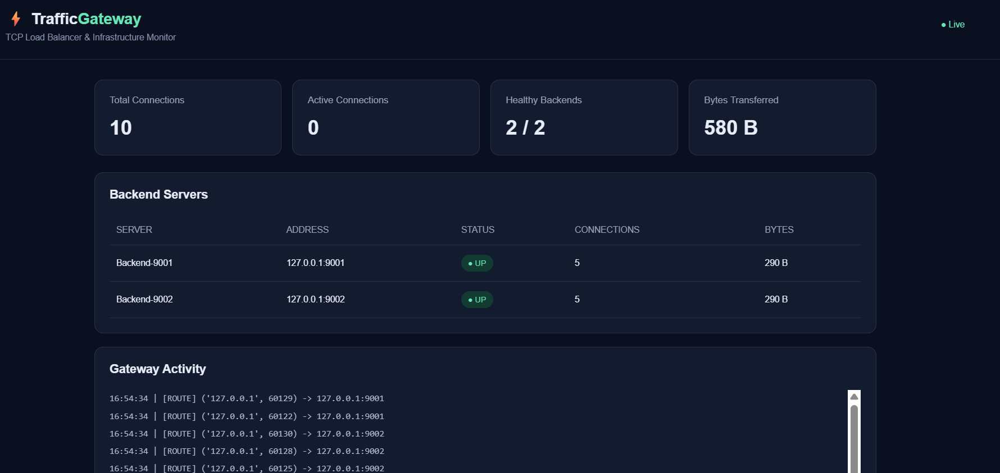
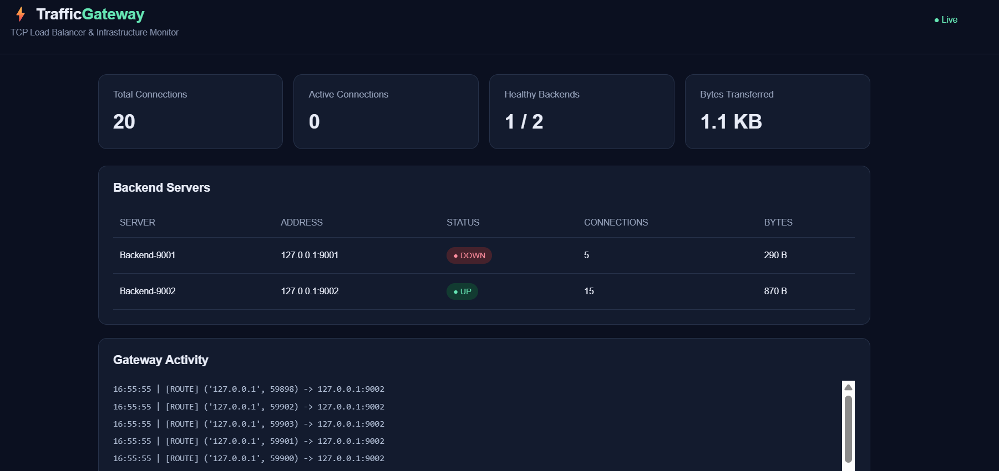
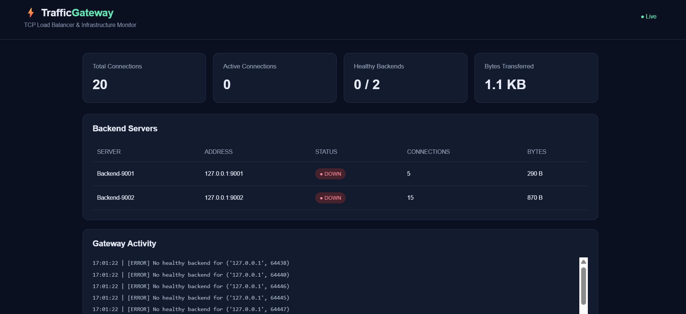

# TrafficGateway ⚡

A lightweight **TCP load balancer and infrastructure monitoring dashboard** built with Python sockets, threading, and HTML/CSS/JavaScript.

TrafficGateway accepts TCP client connections on a gateway port, distributes them across configured backend servers using round-robin routing, checks backend health, and exposes a browser dashboard for monitoring traffic.

## Features

- **TCP proxy gateway** that forwards data between clients and backend servers.
- **Round-robin load balancing** across healthy backends.
- **Backend health monitoring** with UP/DOWN status.
- **Failure handling** that avoids backends marked unhealthy.
- **Live monitoring dashboard** with automatic refresh.
- **Traffic statistics** for total connections, active connections, bytes transferred, and per-backend usage.
- **Gateway activity log** showing routing and health events.
- **Configurable routes and backends** through `config.json`.

## Dashboard screenshots

### Normal operation

Both backend servers are healthy and traffic is distributed between them.



### One backend unavailable

The dashboard reports the unavailable backend and shows traffic being handled by the remaining healthy backend.



### All backends unavailable

The dashboard reports that no backends are healthy and the gateway logs failed routing attempts.



## Architecture

```text
                    TCP clients
                         |
                         v
                 Gateway :8000
              (round-robin routing)
                         |
              +----------+----------+
              |                     |
              v                     v
        Backend-A :9001       Backend-B :9002
              ^                     ^
              +----------+----------+
                         |
                  Health checks

        Browser --> Dashboard :8080 --> /api/status
```

## Project structure

```text
TrafficGateway/
├── gateway.py          # TCP gateway, health monitor, dashboard API
├── backend.py          # Demo TCP backend server
├── test_client.py      # Concurrent client traffic generator
├── config.json         # Gateway routes and backend configuration
├── dashboard.html      # Monitoring dashboard UI
├── assets/
│   ├── dashboard-live.png
│   ├── backend-failure.png
│   └── all-backends-down.png
├── .gitignore
└── README.md
```

> The exact files in your local project may differ. Keep your existing working filenames and update this section if needed.

## Requirements

- Python 3.10 or newer recommended
- Windows, macOS, or Linux
- No third-party Python packages are required if the code uses only the Python standard library.

## Run locally

Open separate terminals from the project directory.

### 1. Start Backend A

```powershell
python backend.py 9001 Backend-A
```

### 2. Start Backend B

```powershell
python backend.py 9002 Backend-B
```

### 3. Start the gateway and dashboard

```powershell
python gateway.py
```

The gateway listens on port `8000`, and the dashboard is available at:

**http://127.0.0.1:8080**

### 4. Generate test traffic

In another terminal:

```powershell
python test_client.py
```

Refresh the dashboard if needed. You should see connection totals, backend health, transferred bytes, and routing events.

## Configuration

Edit `config.json` to change the gateway listener port or backend list. Make sure the ports in the configuration match the ports used when starting each backend.

Example configuration shape:

```json
{
  "routes": [
    {
      "listen_port": 8000,
      "backends": [
        { "host": "127.0.0.1", "port": 9001 },
        { "host": "127.0.0.1", "port": 9002 }
      ]
    }
  ]
}
```

Use the actual `config.json` in your project as the source of truth.

## Test backend failure

1. Start both backends and the gateway.
2. Run `python test_client.py` and verify that both backends receive traffic.
3. Stop one backend with `Ctrl+C`.
4. Check that the dashboard marks it as **DOWN**.
5. Run the client test again and verify that requests are routed to the remaining healthy backend.
6. Restart the stopped backend and check that its status returns to **UP**.

## Current limitations

- This is a local learning/demo project, not a production-hardened load balancer.
- The demo uses plain TCP and does not provide TLS termination, authentication, or encrypted dashboard access.
- Metrics are held in memory and reset when the gateway process restarts.
- Production use would require additional testing, structured logging, graceful shutdown, resource limits, and security hardening.

## Learning outcomes

This project demonstrates practical concepts in:

- TCP sockets and client/server communication
- Concurrent programming with threads
- Round-robin load balancing
- Health checks and failure handling
- HTTP endpoints and browser-based monitoring
- Basic infrastructure observability

## License

No license has been added yet. Add a license file if you want to explicitly permit reuse of this project.
